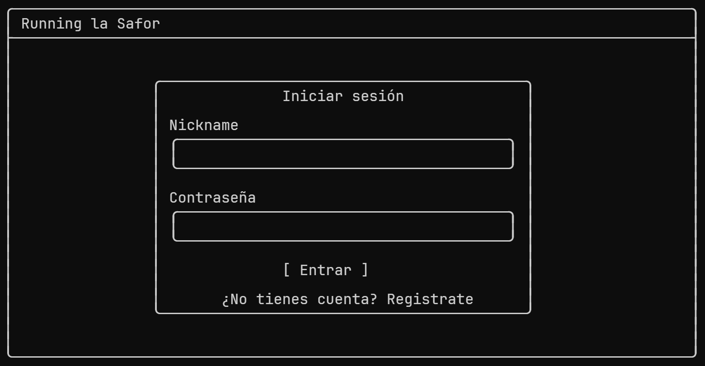
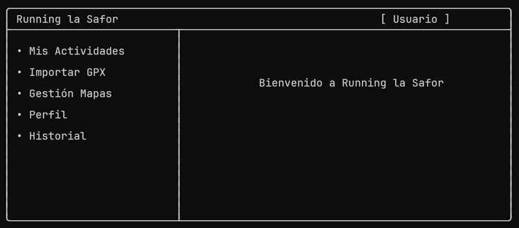
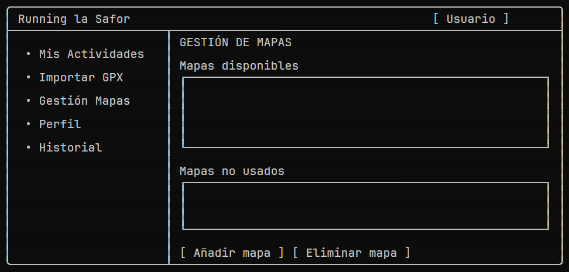

# Running la Safor

Aplicación de escritorio en **JavaFX** para los socios de un club de running: importan sus actividades desde ficheros GPX, las ven sobre el mapa con el perfil de desnivel y la velocidad, añaden anotaciones y consultan sus estadísticas y su historial de uso.

Proyecto de la asignatura **Interfaces Persona-Computador (IPC)** de la Universitat Politècnica de València.

## Funcionalidades

- **Usuarios:** registro con validación de nickname, email, contraseña y edad mínima; inicio y cierre de sesión; edición del perfil y del avatar.
- **Actividades:** importación desde GPX, listado de actividades del usuario y acumulado mensual (número de actividades, distancia, tiempo y desnivel positivo y negativo).
- **Mapa:** trazado de la ruta coloreado según la velocidad, puntos de inicio y fin, y zoom.
- **Perfil de desnivel** enlazado con el mapa: al recorrer la gráfica se marca la posición en la ruta.
- **Anotaciones** sobre la ruta (punto, texto, línea y círculo) con color y grosor, que se pueden editar y borrar.
- **Historial** de sesiones con las actividades importadas y vistas y las anotaciones creadas en cada una.
- **Gestión de mapas:** añadir un mapa nuevo con su imagen y sus coordenadas, o eliminar uno que no esté en uso.

## Prototipos

| Inicio de sesión | Pantalla principal | Mapa |
|---|---|---|
|  |  |  |

El resto de prototipos está en [`docs/prototipos/`](docs/prototipos/).

## Cómo ejecutarla

Requisitos: **JDK 17** o posterior, el **SDK de JavaFX 17** o posterior ([descarga](https://gluonhq.com/products/javafx/)) y **Apache NetBeans**.

1. En NetBeans, ve a *Tools → Libraries → New Library…*, créala con el nombre `JavaFX` y añade todos los `.jar` de la carpeta `lib` del SDK de JavaFX.
2. Abre el proyecto `desarrollo/RunningLaSaforApp` (*File → Open Project*).
3. Pulsa *Run*. La clase principal es `mapademo.MainApp`.

La primera vez que se ejecuta, la aplicación crea la base de datos `sportactivity.db` con los tres mapas de ejemplo (Valencia, Sierra Calderona y Pirineos). Para probarla, regístrate e importa alguno de los ficheros de `desarrollo/RunningLaSaforApp/gpx/`.

## Estructura

| Carpeta | Contenido |
|---|---|
| `desarrollo/RunningLaSaforApp/src/mapademo/controllers` | Controladores de cada pantalla |
| `desarrollo/RunningLaSaforApp/src/mapademo/fxml` | Vistas FXML |
| `desarrollo/RunningLaSaforApp/src/resources` | Hoja de estilos |
| `desarrollo/RunningLaSaforApp/lib` | Librería de la asignatura (`sportactivityapp`) y driver de SQLite |
| `desarrollo/RunningLaSaforApp/maps`, `gpx` | Mapas y rutas de ejemplo |
| `docs/` | Diseño conceptual, diagramas, documento de diseño y prototipos |

## Equipo

| Integrante | Responsabilidad |
|---|---|
| Guillermo | Registro, inicio de sesión, perfil y cierre de sesión; prototipos y documentación final |
| Maria ([@Mariaax6](https://github.com/Mariaax6)) | Actividades: importación GPX, listado, estadísticas y acumulado mensual |
| Álvaro | Mapa: trazado de la ruta, zoom, puntos inicial y final, y anotaciones |
| Héctor | Historial de sesiones, gestión de mapas y revisión de la documentación |

El reparto detallado está en [`docs/Reparto-trabajo.md`](docs/Reparto-trabajo.md).

## Material de la asignatura

La librería `sportactivityapp` (modelo de datos, lectura de GPX y persistencia en SQLite), el proyecto base, los mapas, el script `maps/generar_mapas_hd.py` y los ficheros GPX de ejemplo los proporcionó el profesorado de IPC.
